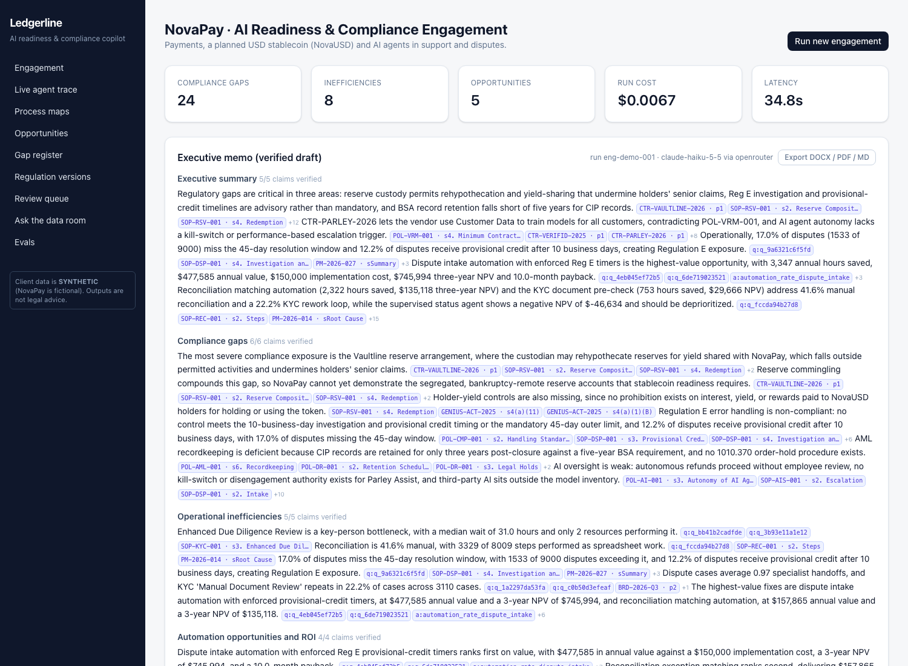
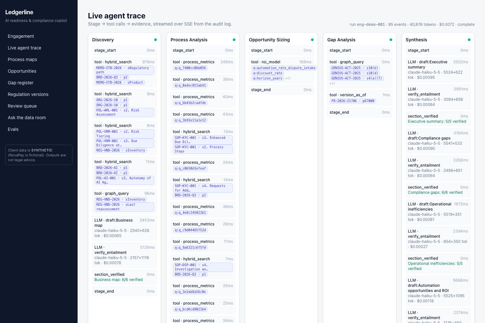
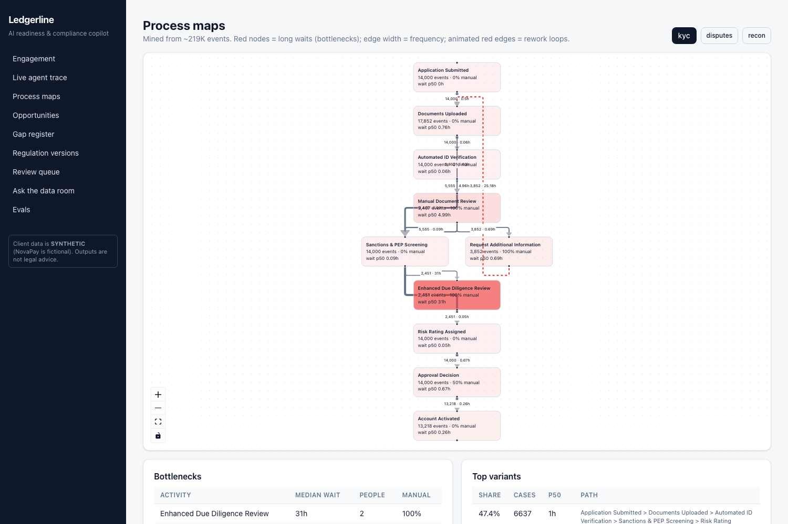
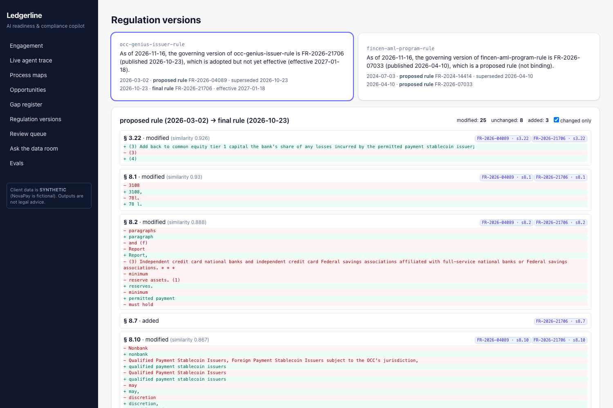
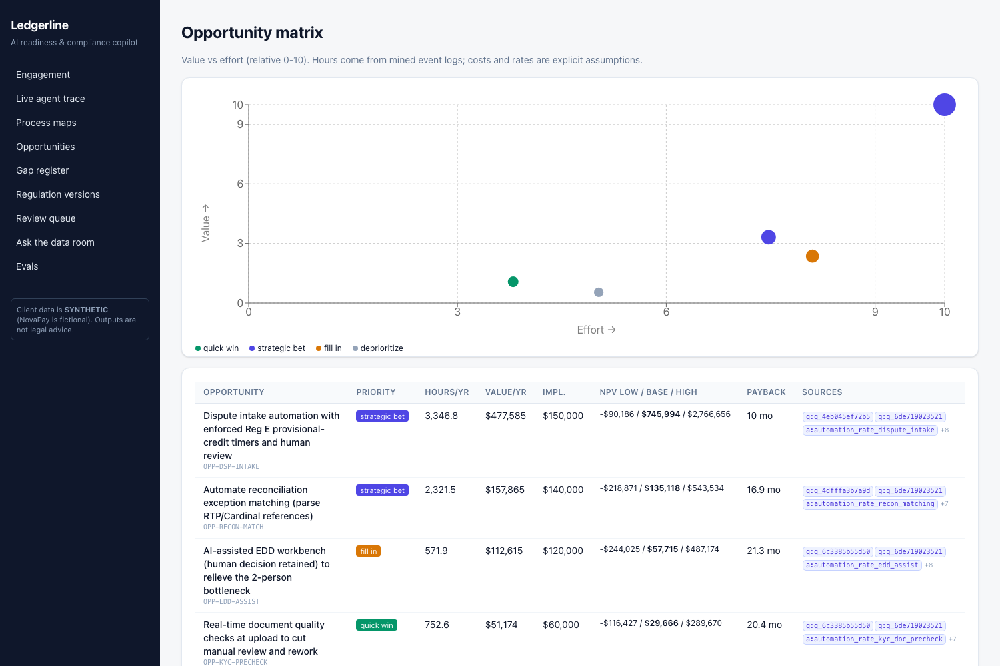
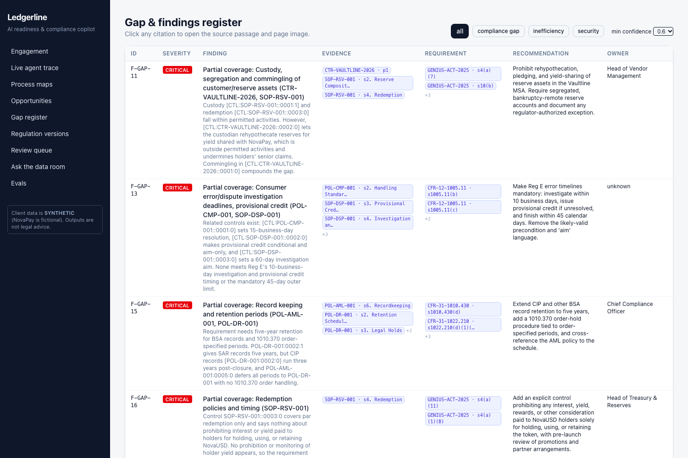
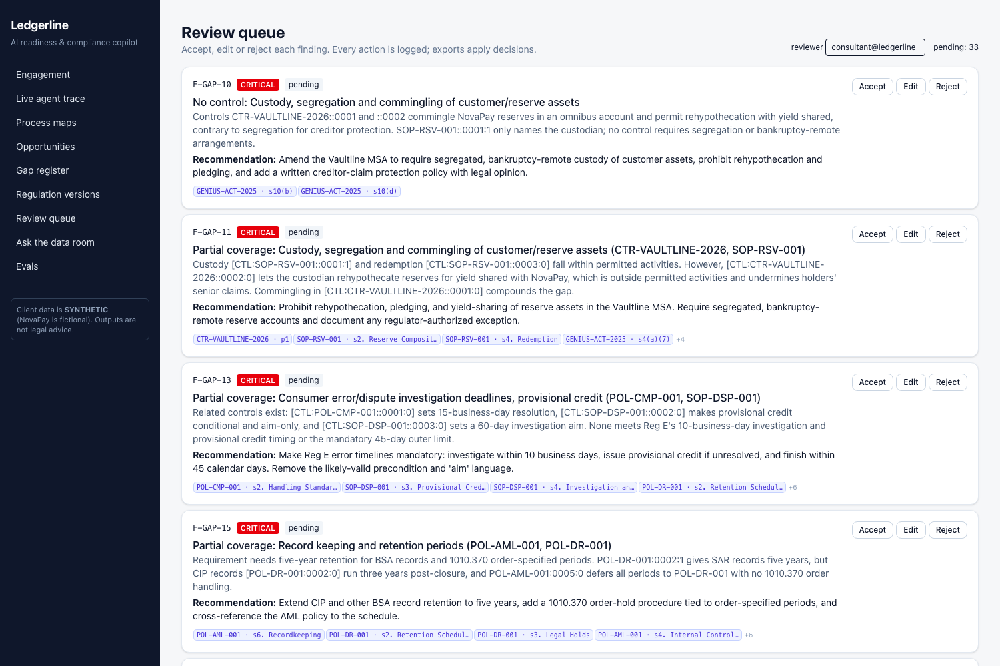
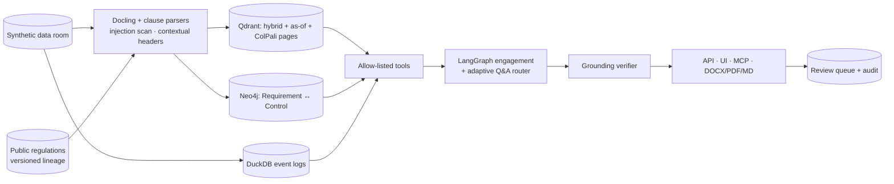
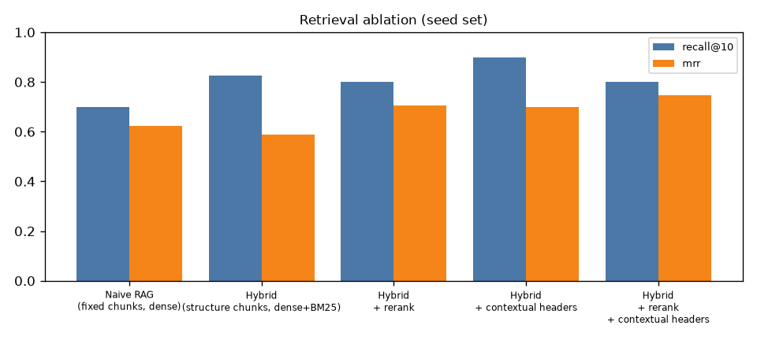

# Ledgerline

**An AI consulting copilot for fintech engagements.** Point it at a client's data room and it runs an *AI-readiness & compliance* engagement end to end:
1. It maps the business.
2. It mines processes from event logs.
3. It sizes automation opportunities with a transparent ROI model.
4. It runs a regulatory gap analysis with clause-level citations.
5. It drafts a consultant-grade memo, findings register and 90-day roadmap for human review.

**Every sentence it writes is traceable** to a document clause or page, a re-runnable data query, or a named model assumption. A verifier removes any claim it can't back up.

> The client, **NovaPay**, is a **synthetic** fintech: payments, a planned USD stablecoin, and AI agents piloted in support and disputes. The regulatory corpus is real and public: the GENIUS Act, OCC/FDIC/Treasury implementing rules, FinCEN, Reg E/Z, NIST AI RMF and the EU AI Act. Outputs are **not legal advice**.



## What makes it different

| Capability | How it works |
|---|---|
| **Clause-level citations** | Federal Register XML, eCFR and GPO statute text are parsed into clause trees, e.g. `[doc:GENIUS-ACT-2025#s4(a)(3)]`. Clicking a citation in the UI opens the exact passage and the rendered page. |
| **Version-aware (temporal) RAG** | Every regulatory chunk carries `valid_from`/`valid_to` and lineage. An *as-of* query returns the version that governed on that date, with its legal status: proposed, adopted but not yet effective, or effective. `diff_versions` explains what changed between the proposed and final rule. |
| **Multimodal retrieval** | Board-deck charts are indexed with a ColPali-family model (late interaction, Qdrant multivectors). Claude reads the retrieved page images to recover values that exist *only* in charts. |
| **Process mining** | About 219K events become cycle times, rework loops, handoffs and a two-person EDD bottleneck. Queries are whitelisted and read-only, each with a reproducible `[q:…]` id and result hash. |
| **Knowledge-graph gap analysis** | Requirement nodes are extracted selectively from regulations and Control nodes from client policies, in Neo4j. A gap is a *graph query* (no satisfying control) plus an LLM judgment with evidence. |
| **Transparent ROI** | Hours saved come from mined data. Costs, rates and ramps are YAML assumptions with low/base/high values, plus a tornado sensitivity. The LLM never does the arithmetic. |
| **Agentic, adaptive routing** | The cheap hybrid path runs first. A self-check escalates to a bounded Claude tool-use loop, and every stage has a tool allow-list enforced in code. |
| **Grounding verifier** | Each sentence needs a citation, every number must match its source after rounding, and an entailment judge checks the claim. Otherwise the system answers "insufficient evidence" instead of guessing. |
| **Human-in-the-loop** | A review queue lets a reviewer accept, edit or reject each finding, with an append-only log. Exports apply the decisions. Every step, tool call, token and cent is audited and can be exported to OpenTelemetry/Langfuse. |
| **Guardrails** | A malicious document is seeded in the data room, with hidden white text and a metadata payload. It is detected and quarantined at ingest. |
| **MCP server** | `run_engagement`, `ask_dataroom`, `gap_check`, `size_opportunity` and `diff_regulation` let Claude Desktop or Claude Code drive Ledgerline. |

## Run it in 5 minutes

You need Docker, [uv](https://docs.astral.sh/uv/), Node 22, and **one** LLM key: either Anthropic or OpenRouter.

```bash
git clone https://github.com/arfujj/ledgerline && cd ledgerline
cp .env.example .env            # set ANTHROPIC_API_KEY or OPENROUTER_API_KEY
uv sync --all-extras            # Python 3.12; 'visual' extra = ColPali, 'mining' = PM4Py
make demo                       # services + data room + corpus + indexes + graph + one engagement
open http://localhost:3000      # UI   ·   http://localhost:8000/docs  (API)
```

- **`make demo` steps:** it starts Qdrant, Neo4j, Postgres, the API and the UI, generates the synthetic data room, fetches the small regulatory slice, then ingests and indexes. It then builds the process DB, the ColPali page index and the knowledge graph, runs one engagement and exports the deliverables.
- **Cost:** every role runs on **Claude Haiku 5.5**. Embeddings, BM25, reranking and ColPali all run locally. Hard spend caps ($1 per run, $5 per day) are enforced in the client.

Other entry points:

```bash
make ask Q="Does NovaPay's dispute procedure meet Regulation E provisional credit timing?"
make eval            # full evaluation suite -> evals/report.md -> the tables below
make review          # review LLM-generated golden questions in the terminal
make mcp             # MCP server over stdio (see docs/MCP.md)
make observability   # self-hosted Langfuse; then LEDGERLINE_OTEL_EXPORTER=otlp
```

## Sample output

From the generated [executive memo](docs/sample/executive_memo.md), produced by Claude Haiku 5.5. Every sentence is verified:

> Enhanced Due Diligence Review is a key-person bottleneck, with a median wait of 31.0 hours and only 2 resources performing it. [q:…] Reconciliation is 41.6% manual, with 3,329 of 8,009 steps performed as spreadsheet work. [q:…] Provisional credit is issued after 10 business days in 12.2% of disputes, creating Regulation E exposure. [q:…][doc:SOP-DSP-001 §3]

Also generated: the [findings register](docs/sample/findings_register.md), the [90-day roadmap](docs/sample/roadmap_90_day.md), the [ROI summary](docs/sample/roi_summary.md) (with scenarios, tornado drivers and an assumptions appendix), and PDF and DOCX versions of each.

| Live agent trace | Process mining | Regulation versions |
|---|---|---|
|  |  |  |
| **Opportunity matrix** | **Findings register** | **Review queue** |
|  |  |  |

## Architecture



The full design is in [docs/ARCHITECTURE.md](docs/ARCHITECTURE.md). Twelve architecture decision records are in [docs/DECISIONS.md](docs/DECISIONS.md), covering temporal retrieval, selective graph extraction, ColPali, ROI assumptions, the router and verifier, guardrails and the cost profile.

## Measured results

Everything below is **copied by a script** from [`evals/report.md`](evals/report.md), which is produced by actually running `make eval`. CI fails if the README drifts from the report. Nothing here is hand-entered.

<!-- METRICS:START -->
_Copied verbatim from [evals/report.md](evals/report.md) (Generated 2026-11-17 02:27 UTC from commit `9dde552`)._

## Retrieval ablation

Dataset: **seed retrieval set v0**, made up of author-written questions (`evals/data/seed_retrieval.jsonl`) over the data room and regulatory corpus. Gold sources are a document plus a verbatim anchor span, so every chunking strategy is scored the same way. Retrieval is local (FastEmbed), so these runs cost $0.

| Configuration | n | Recall@5 | Recall@10 | MRR | nDCG@10 | p50 ms | p95 ms |
|---|---|---|---|---|---|---|---|
| Naive RAG (fixed chunks, dense) | 40 | 0.675 | 0.700 | 0.623 | 0.642 | 7.7 | 23.8 |
| Hybrid (structure chunks, dense+BM25) | 40 | 0.725 | 0.825 | 0.589 | 0.645 | 7.8 | 10.3 |
| Hybrid + rerank | 40 | 0.775 | 0.800 | 0.705 | 0.728 | 2188.6 | 3640.4 |
| Hybrid + contextual headers | 40 | 0.875 | 0.900 | 0.699 | 0.750 | 10.7 | 34.1 |
| Hybrid + rerank + contextual headers | 40 | 0.800 | 0.800 | 0.746 | 0.760 | 2172.4 | 2776.4 |



Per-type results for the best configuration (**Hybrid + rerank + contextual headers**):

| Type | Recall@5 | Recall@10 | MRR | nDCG@10 |
|---|---|---|---|---|
| fact | 0.870 | 0.870 | 0.819 | 0.832 |
| regulatory | 0.583 | 0.583 | 0.542 | 0.553 |
| table | 1.000 | 1.000 | 0.900 | 0.926 |
## Answer-level ablation

Dataset: **LLM-generated candidates (pending human review)**. Stratified sample of 8 items per question type (n=56), identical across configs. Model: Claude Haiku 5.5 for every role. Answer correctness is deterministic for numeric, visual, template-temporal and unanswerable items, and graded by a Claude Haiku judge against the reference answer for the rest. The hallucinated-claim rate comes from the same independent post-hoc entailment check for every config.

| Config | Correct | Numeric | Temporal | Refusal | False refusal | Cite prec. | Halluc. claims | p50 ms | p95 ms | $/question |
|---|---|---|---|---|---|---|---|---|---|---|
| L1 Naive RAG (fixed chunks, dense) | 0.321 | 0.000 | 0.250 | 1.000 | 0.708 | 0.846 | 0.346 | 1,186 | 4,009 | 0.00116 |
| L2 Hybrid (structure chunks, dense+BM25) | 0.446 | 0.000 | 0.312 | 1.000 | 0.583 | 0.910 | 0.057 | 1,001 | 3,851 | 0.00095 |
| L3 + contextual headers | 0.420 | 0.000 | 0.250 | 1.000 | 0.562 | 0.881 | 0.024 | 1,226 | 4,313 | 0.00106 |
| L4 + visual (ColPali + page reading) | 0.554 | 0.438 | 0.438 | 1.000 | 0.396 | 0.899 | 0.061 | 1,359 | 14,457 | 0.00154 |
| L5 + knowledge graph | 0.562 | 0.375 | 0.312 | 1.000 | 0.375 | 0.907 | 0.035 | 1,309 | 7,343 | 0.00161 |
| L6 + temporal (as-of) | 0.545 | 0.375 | 0.688 | 1.000 | 0.375 | 0.924 | 0.036 | 1,162 | 7,772 | 0.00139 |
| L7 Full: agentic escalation + verifier | 0.688 | 0.625 | 0.750 | 1.000 | 0.146 | 0.893 | 0.057 | 5,848 | 13,519 | 0.00690 |

Full system (L7) on **all 244 items**, by question type:

| Type | n | Correct | Cite prec. | Retrieval hit | Halluc. claims | p50 ms | $/question |
|---|---|---|---|---|---|---|---|
| fact | 79 | 0.804 | 0.750 | 0.962 | 0.016 | 3,393 | 0.00434 |
| multi_hop | 30 | 0.450 | 0.689 | 0.667 | 0.038 | 9,684 | 0.01141 |
| numeric | 10 | 0.400 | - | - | 0.167 | 7,842 | 0.00758 |
| table | 26 | 0.712 | 0.970 | 0.846 | 0.114 | 4,523 | 0.00489 |
| temporal | 61 | 0.787 | 0.962 | 0.826 | 0.009 | 2,895 | 0.00400 |
| unanswerable | 30 | 0.967 | - | - | 0.000 | 5,634 | 0.01106 |
| visual | 8 | 1.000 | 1.000 | - | 0.083 | 10,459 | 0.00768 |
| overall | 244 | 0.756 | 0.846 | 0.867 | 0.034 | 4,598 | 0.00625 |
## Cost and latency per engagement

| Run | Model | Cost (USD) | Wall time (s) | Memo claims verified | Findings |
|---|---|---|---|---|---|
| eng-demo-001 | claude-haiku-5-5 via openrouter | 0.0067 | 34.8 | 20/20 | 33 |
## Temporal (as-of) correctness

As-of questions over versioned rulemakings (OCC GENIUS Act issuer rule proposed→final; FinCEN AML/CFT program NPRM 2024→2026). An item is correct when the top retrieved chunk from that lineage comes from the version that governed on the as-of date. Items are built from the corpus manifest by a template.

| Retrieval | n | Temporal correctness |
|---|---|---|
| Hybrid, no version filter | 38 | 0.500 |
| Hybrid + as-of version filter | 38 | 1.000 |
## Answer-key scoring (seeded gaps and inefficiencies)

Findings are matched to the eval-only answer key with a deterministic rule: the finding must cite one of the item's evidence documents and mention a distinctive keyword. Precision counts real but *unseeded* findings as false positives, so it is a lower bound. Unmatched findings are listed in `evals/results/answer_key.json` for human review.

| Run | Findings | Precision | Recall | Severity exact | Severity ±1 | Missed |
|---|---|---|---|---|---|---|
| Graph gap analysis: all findings | 24 | 0.583 | 0.909 | 0.500 | 0.900 | GAP-08 |
| Graph gap analysis: confidence >= 0.6 | 18 | 0.611 | 0.818 | 0.556 | 0.889 | GAP-05, GAP-08 |
| Full engagement: compliance gaps | 24 | 0.583 | 0.909 | 0.500 | 0.900 | GAP-08 |
| Full engagement: inefficiencies | 8 | 1.000 | 1.000 | 0.750 | 1.000 | - |
## Guardrails: prompt-injection detection at ingest

| Seeded injection docs | Detected | Detection recall | False positives | Clean docs scanned |
|---|---|---|---|---|
| 1 | 1 | 1.00 | 0 | 55 |
<!-- METRICS:END -->

## Engineering

- **Toolchain:** Python 3.12 with uv (exact pins), `ruff`, `mypy --strict` on core, and `pytest` with coverage gated at 80% or more. The Next.js UI uses TypeScript, Tailwind, React Flow and Recharts.
- **Reproducibility:** the data room generator is deterministic, so the same seed produces byte-identical files.
- **Answer-key isolation:** the eval-only answer key is guarded so the app can never read it, enforced by a code scan, a path guard and tests.
- **Regulatory fetcher:** idempotent and cached (ETag and sha256), with live Federal Register and eCFR metadata. Lineage is validated.
- **CI:** lint, typecheck, tests, a README/report sync check and a deterministic eval subset that needs no API key and fails on regressions.
- **Licensing:** PM4Py (AGPL) is an optional extra. Core process metrics are plain DuckDB SQL (see ADR-006).

```
src/ledgerline/  core · corpus · ingest · retrieval · graph · process · roi · agents · deliverables · review · api · mcp_server
synth/           synthetic NovaPay generator (generator-side only)
evals/           retrieval, temporal, answer-key, guardrail and answer-level evals, plus the report
ui/              Next.js app
docs/            architecture, ADRs, MCP guide, samples, screenshots
```

## Honest limitations

- **Unreviewed golden set.** The golden Q&A set was generated by an LLM, filtered for verbatim anchors, and is still awaiting human review. Run `make review`, then `make eval`.
- **Single model.** One small model (Haiku 5.5) answers, judges and verifies. Deterministic scoring is used wherever possible.
- **Same author.** The data room's seeded issues and the inefficiency detectors were written by the same author, so answer-key recall is optimistic. The report says so.

## License

MIT for this repository's code. Regulatory texts are public documents from their issuers. The NovaPay data room is synthetic.
