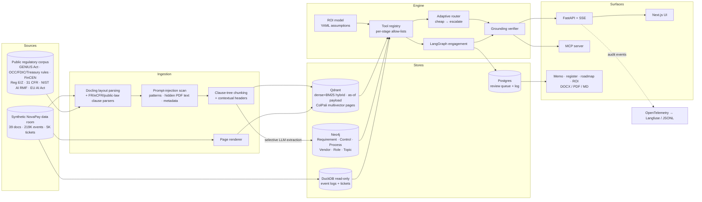
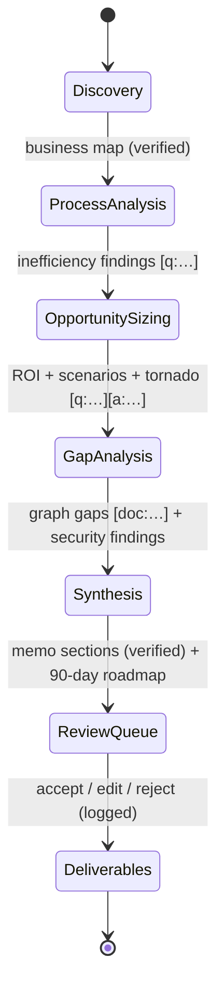
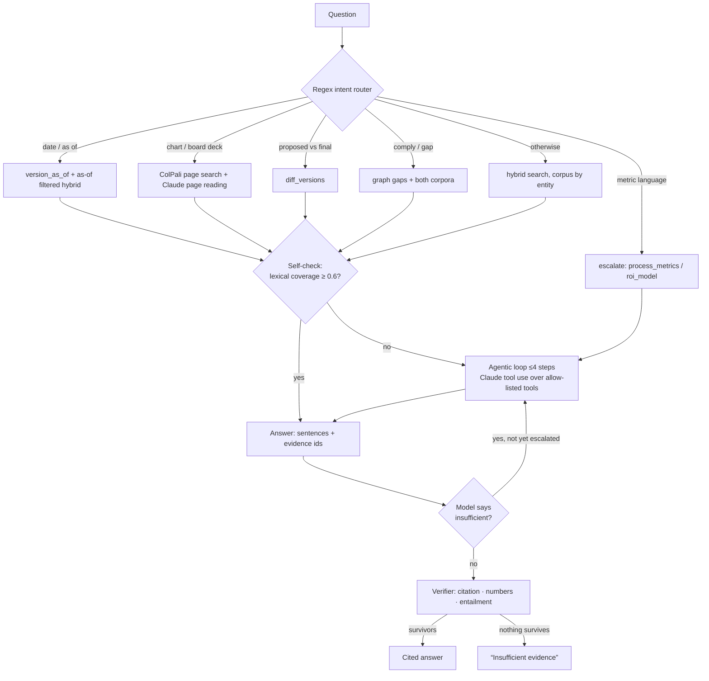

# Ledgerline architecture

## System overview

## Engagement state machine (LangGraph)

| Stage | Allowed tools | Output |
|---|---|---|
| Discovery | `hybrid_search`, `graph_query` | Business map section (verified) and document inventory |
| Process analysis | `process_metrics`, `hybrid_search`, `calculator` | Inefficiency findings from generic threshold detectors |
| Opportunity sizing | `roi_model`, `process_metrics`, `calculator` | Base case, scenarios and sensitivity |
| Gap analysis | `graph_query`, `hybrid_search`, `diff_versions`, `version_as_of` | Gap findings and prompt-injection security findings |
| Synthesis | `draft_section` | Memo sections (verified) and roadmap |

## Q&A router

## Citations and traceability

| Citation | Meaning | Resolved to |
|---|---|---|
| `[doc:GENIUS-ACT-2025#s4(a)(3)]` | Document clause | Statute text for that clause, plus the source URL |
| `[doc:BRD-2026-Q3#p1]` | Document page | Passage and rendered page image (clickable in the UI) |
| `[q:q_fccda94b27d8]` | Data query | Logged SQL, parameters and result hash; re-run by the verifier |
| `[a:automation_rate_recon_matching]` | Model assumption | Value, range, unit and rationale from `config/roi_assumptions.yaml` |
| `[calc]` | Deterministic arithmetic | Calculator tool (safe arithmetic only, no code execution) |

## Cost profile

Every LLM role uses Claude Haiku 5.5, through OpenRouter or the Anthropic API. Embeddings, BM25, reranking and ColPali all run locally. Responses and embeddings are cached on disk. Spend caps apply per run and per day. Measured costs are in `evals/report.md`.
