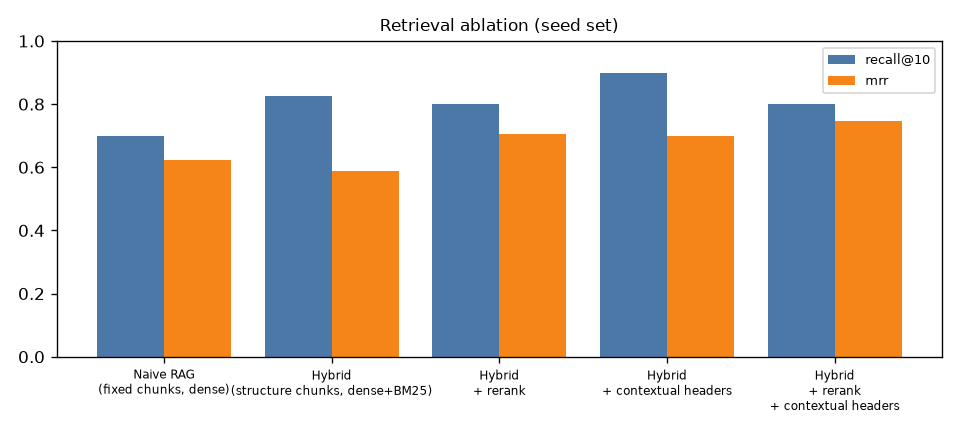

# Ledgerline evaluation report

Generated 2026-11-17 02:27 UTC from commit `9dde552` by `evals/report.py`. Every number below is read from `evals/results/*.json`, produced by actually running the evals. Nothing is hand-entered.

## Retrieval ablation

Dataset: **seed retrieval set v0**, made up of author-written questions (`evals/data/seed_retrieval.jsonl`) over the data room and regulatory corpus. Gold sources are a document plus a verbatim anchor span, so every chunking strategy is scored the same way. Retrieval is local (FastEmbed), so these runs cost $0.

| Configuration | n | Recall@5 | Recall@10 | MRR | nDCG@10 | p50 ms | p95 ms |
|---|---|---|---|---|---|---|---|
| Naive RAG (fixed chunks, dense) | 40 | 0.675 | 0.700 | 0.623 | 0.642 | 7.7 | 23.8 |
| Hybrid (structure chunks, dense+BM25) | 40 | 0.725 | 0.825 | 0.589 | 0.645 | 7.8 | 10.3 |
| Hybrid + rerank | 40 | 0.775 | 0.800 | 0.705 | 0.728 | 2188.6 | 3640.4 |
| Hybrid + contextual headers | 40 | 0.875 | 0.900 | 0.699 | 0.750 | 10.7 | 34.1 |
| Hybrid + rerank + contextual headers | 40 | 0.800 | 0.800 | 0.746 | 0.760 | 2172.4 | 2776.4 |

Per-type results for the best configuration (**Hybrid + rerank + contextual headers**):

| Type | Recall@5 | Recall@10 | MRR | nDCG@10 |
|---|---|---|---|---|
| fact | 0.870 | 0.870 | 0.819 | 0.832 |
| regulatory | 0.583 | 0.583 | 0.542 | 0.553 |
| table | 1.000 | 1.000 | 0.900 | 0.926 |

## Answer-level ablation

Dataset: **LLM-generated candidates (pending human review)**. Stratified sample of 8 items per question type (n=56), identical across configs. Model: Claude Haiku 5.5 for every role. Answer correctness is deterministic for numeric, visual, template-temporal and unanswerable items, and graded by a Claude Haiku judge against the reference answer for the rest. The hallucinated-claim rate comes from the same independent post-hoc entailment check for every config.

| Config | Correct | Numeric | Temporal | Refusal | False refusal | Cite prec. | Halluc. claims | p50 ms | p95 ms | $/question |
|---|---|---|---|---|---|---|---|---|---|---|
| L1 Naive RAG (fixed chunks, dense) | 0.321 | 0.000 | 0.250 | 1.000 | 0.708 | 0.846 | 0.346 | 1,186 | 4,009 | 0.00116 |
| L2 Hybrid (structure chunks, dense+BM25) | 0.446 | 0.000 | 0.312 | 1.000 | 0.583 | 0.910 | 0.057 | 1,001 | 3,851 | 0.00095 |
| L3 + contextual headers | 0.420 | 0.000 | 0.250 | 1.000 | 0.562 | 0.881 | 0.024 | 1,226 | 4,313 | 0.00106 |
| L4 + visual (ColPali + page reading) | 0.554 | 0.438 | 0.438 | 1.000 | 0.396 | 0.899 | 0.061 | 1,359 | 14,457 | 0.00154 |
| L5 + knowledge graph | 0.562 | 0.375 | 0.312 | 1.000 | 0.375 | 0.907 | 0.035 | 1,309 | 7,343 | 0.00161 |
| L6 + temporal (as-of) | 0.545 | 0.375 | 0.688 | 1.000 | 0.375 | 0.924 | 0.036 | 1,162 | 7,772 | 0.00139 |
| L7 Full: agentic escalation + verifier | 0.688 | 0.625 | 0.750 | 1.000 | 0.146 | 0.893 | 0.057 | 5,848 | 13,519 | 0.00690 |

Full system (L7) on **all 244 items**, by question type:

| Type | n | Correct | Cite prec. | Retrieval hit | Halluc. claims | p50 ms | $/question |
|---|---|---|---|---|---|---|---|
| fact | 79 | 0.804 | 0.750 | 0.962 | 0.016 | 3,393 | 0.00434 |
| multi_hop | 30 | 0.450 | 0.689 | 0.667 | 0.038 | 9,684 | 0.01141 |
| numeric | 10 | 0.400 | - | - | 0.167 | 7,842 | 0.00758 |
| table | 26 | 0.712 | 0.970 | 0.846 | 0.114 | 4,523 | 0.00489 |
| temporal | 61 | 0.787 | 0.962 | 0.826 | 0.009 | 2,895 | 0.00400 |
| unanswerable | 30 | 0.967 | - | - | 0.000 | 5,634 | 0.01106 |
| visual | 8 | 1.000 | 1.000 | - | 0.083 | 10,459 | 0.00768 |
| overall | 244 | 0.756 | 0.846 | 0.867 | 0.034 | 4,598 | 0.00625 |

## Cost and latency per engagement

| Run | Model | Cost (USD) | Wall time (s) | Memo claims verified | Findings |
|---|---|---|---|---|---|
| eng-demo-001 | claude-haiku-5-5 via openrouter | 0.0067 | 34.8 | 20/20 | 33 |

## Temporal (as-of) correctness

As-of questions over versioned rulemakings (OCC GENIUS Act issuer rule proposed→final; FinCEN AML/CFT program NPRM 2024→2026). An item is correct when the top retrieved chunk from that lineage comes from the version that governed on the as-of date. Items are built from the corpus manifest by a template.

| Retrieval | n | Temporal correctness |
|---|---|---|
| Hybrid, no version filter | 38 | 0.500 |
| Hybrid + as-of version filter | 38 | 1.000 |

## Answer-key scoring (seeded gaps and inefficiencies)

Findings are matched to the eval-only answer key with a deterministic rule: the finding must cite one of the item's evidence documents and mention a distinctive keyword. Precision counts real but *unseeded* findings as false positives, so it is a lower bound. Unmatched findings are listed in `evals/results/answer_key.json` for human review.

| Run | Findings | Precision | Recall | Severity exact | Severity ±1 | Missed |
|---|---|---|---|---|---|---|
| Graph gap analysis: all findings | 24 | 0.583 | 0.909 | 0.500 | 0.900 | GAP-08 |
| Graph gap analysis: confidence >= 0.6 | 18 | 0.611 | 0.818 | 0.556 | 0.889 | GAP-05, GAP-08 |
| Full engagement: compliance gaps | 24 | 0.583 | 0.909 | 0.500 | 0.900 | GAP-08 |
| Full engagement: inefficiencies | 8 | 1.000 | 1.000 | 0.750 | 1.000 | - |

## Guardrails: prompt-injection detection at ingest

| Seeded injection docs | Detected | Detection recall | False positives | Clean docs scanned |
|---|---|---|---|---|
| 1 | 1 | 1.00 | 0 | 55 |

## Not yet measured

These metrics require later phases or an approved golden set, and are deliberately left blank rather than estimated: answer correctness, faithfulness, citation precision, numeric accuracy, refusal accuracy, hallucinated-claim rate, cost per engagement.
